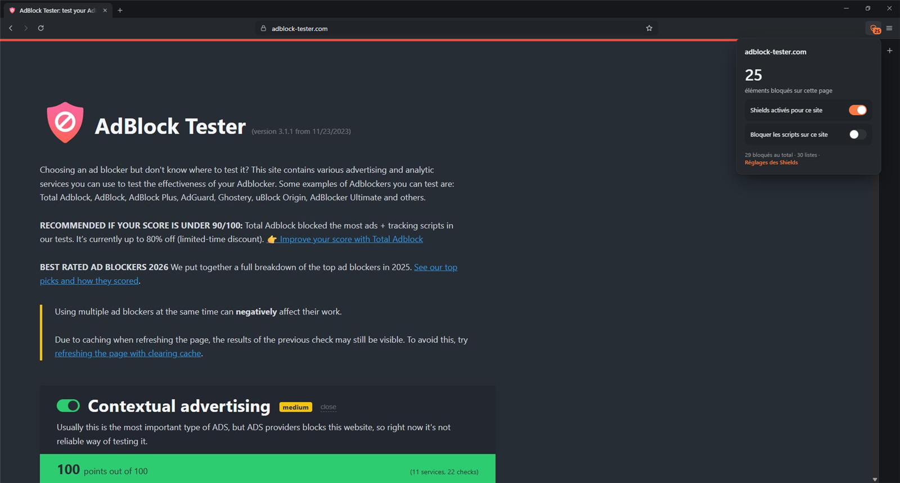
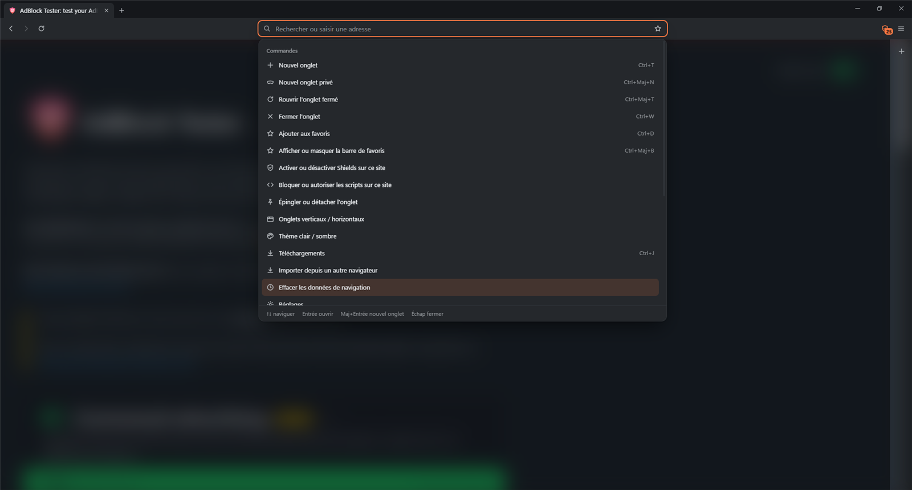
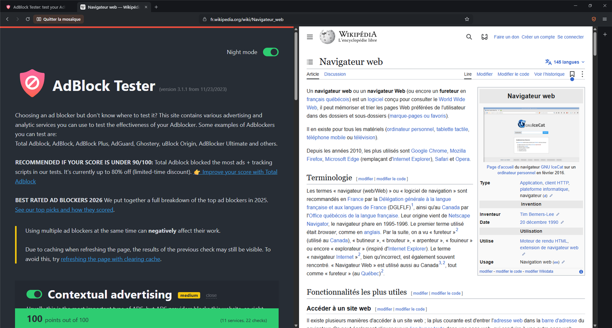
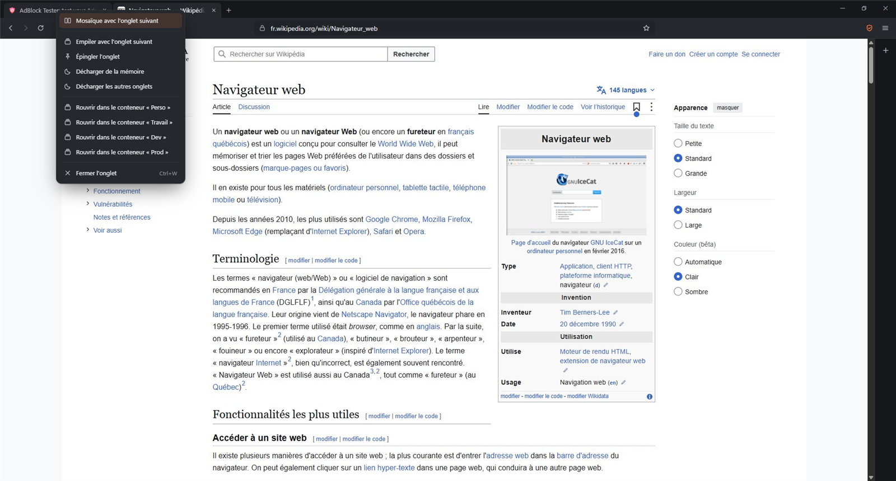
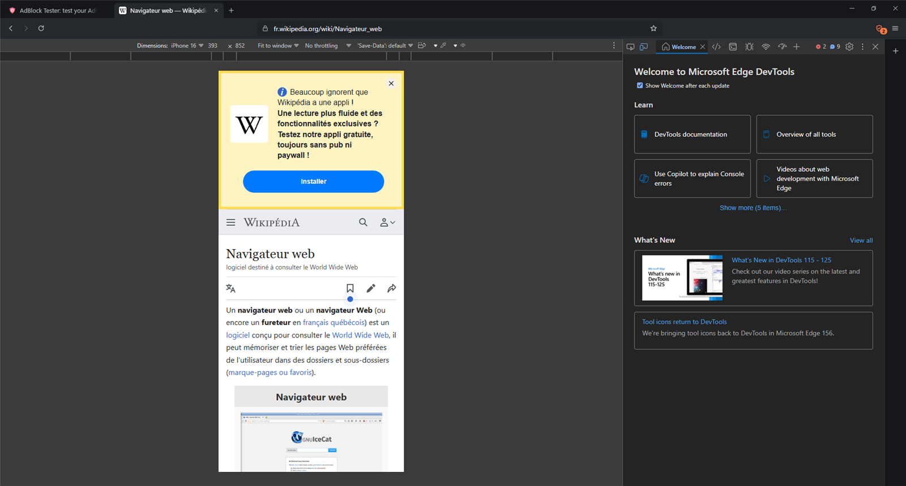
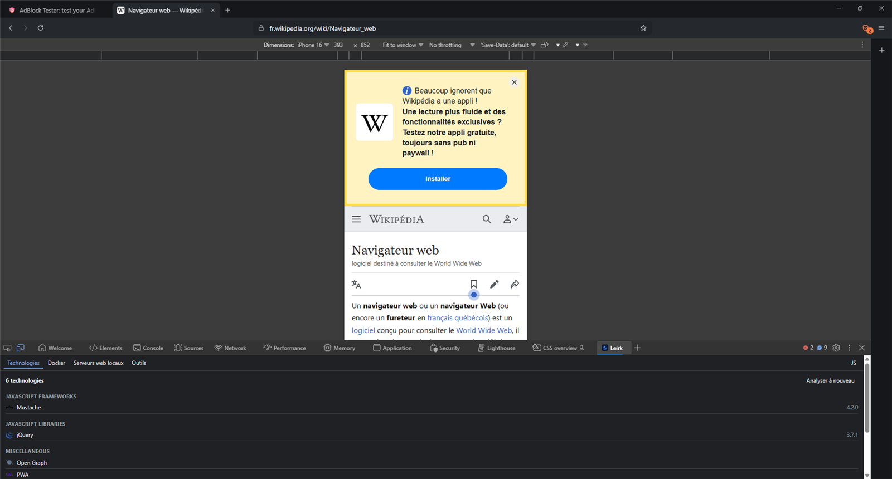
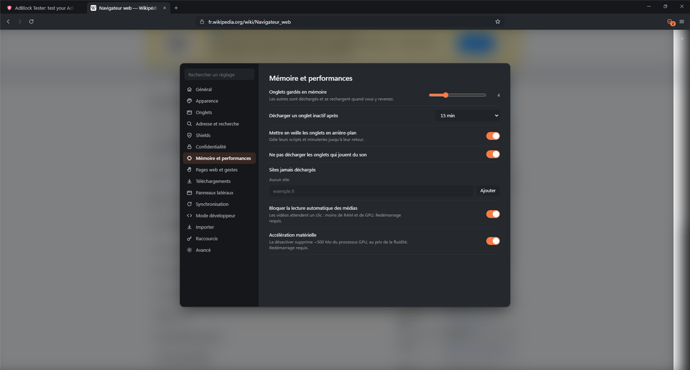
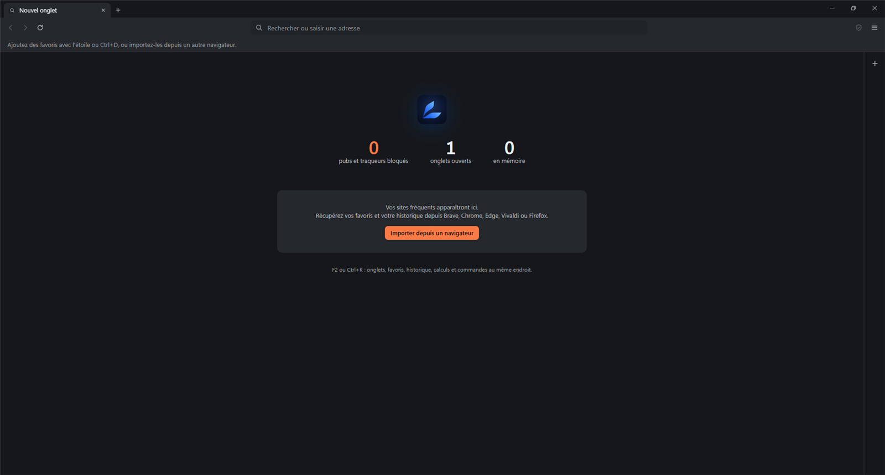

<div align="center">


# Leirk

**A featherweight Windows browser written in Rust.**
Brave's Shields and ergonomics, Vivaldi's power tools, Chrome's DevTools — in a 6 MB executable
that keeps 50 tabs open for the RAM other browsers spend on a handful.

[](https://github.com/jeromedevivo/Leirk-web/releases/latest)


-4285f4)


[**Download**](#download) · [Features](#features) · [Memory](#why-it-stays-light) · [Build](#build-from-source) · [Architecture](#architecture)

🇫🇷 *Leirk est un navigateur Windows ultra-léger écrit en Rust : les Shields et l'ergonomie de Brave, les piles d'onglets, la mosaïque et les commandes rapides de Vivaldi, les DevTools de Chrome. Interface en français.*

<br>



</div>

---

## Why Leirk

| | |
|---|---|
| 🪶 **Light by design** | A tab is a row of data, not a process. Only the tabs you look at own a rendering engine; the rest sleep, then unload. 51 restored tabs: **~340 MB**. |
| 🛡️ **Private by default** | Brave's `adblock-rust` engine with 30 filter lists, scriptlets, cosmetic filtering, HTTPS upgrade, tracking-parameter stripping and Global Privacy Control. **100/100** on adblock-tester.com. |
| ⚡ **Built for power users** | Command palette (F2), tab stacks, 2–4 tab tiling, mouse gestures, side panels, full-page capture, and Chromium's own DevTools docked in the window. |

## Download

| | File | For |
|---|---|---|
| 💿 **Installer** | `Leirk-Setup-<version>.exe` | Per-user install, no administrator prompt. Start menu entry, optional desktop shortcut, clean uninstall. |
| 🎒 **Portable** | `Leirk-<version>-portable.zip` | Unzip anywhere (USB stick included) and run `leirk.exe`. Bookmarks, history and settings live in `data\` next to the exe. |

👉 **[Get the latest release](https://github.com/jeromedevivo/Leirk-web/releases/latest)**

Requires Windows 10 or 11 (x64) with the Microsoft Edge WebView2 runtime, which ships with Windows 11.

## Features

### 🛡️ Shields — Brave's blocker, natively


- Brave's **adblock-rust** engine with Brave's list catalog: uBlock Origin filters, EasyList, EasyPrivacy, URLhaus, Brave lists, cookie-banner lists, AdGuard French — **30 lists** out of the box.
- **Scriptlets** and **neutral redirects** from Brave's resources, plus generic and per-site **cosmetic filtering** injected as the document is created.
- Three levels (Standard, Aggressive, Off), custom lists and personal filters, a per-site switch and **one-click JavaScript blocking**.
- **HTTPS upgrade**, tracking-parameter removal (`utm_*`, `fbclid`, `gclid`…), Global Privacy Control, ping blocking, private tabs, and clear-on-exit.

### ⌨️ Quick commands — everything is one keystroke away



Press **F2** or **Ctrl+K** to search tabs, bookmarks and history, run any command, or type a sum like `12*7+3` for an instant answer. Use any of **28 search engines** with a keyword or a bang: `g cats`, `!yt lofi`, `w Rust`.

### 🪟 Tiling, stacks and lazy tabs



Show **2–4 tabs side by side**, stack related tabs together, use vertical or horizontal tabs, and **unload any tab from its right-click menu**. Hover cards preview a tab with its live memory usage.



### 🛠️ Chromium DevTools, docked like Chrome — plus a Leirk panel



**F12** or right-click → *Inspecter* opens Chromium's own DevTools inside the window: device emulation next to the element picker, dock left, bottom or right, or undock into its own window.

Turn on **developer mode** and a **Leirk** tab joins them:

- **Technologies**: a Wappalyzer-style stack detector covering frameworks, CMS, libraries and their versions.
- **Docker**: Compose projects first, then their containers; start, stop or restart a whole project in one click.
- **Local web servers**: only the ports that actually serve a site, Vite on `[::1]` included.
- **Tools**: JWT decoder, Base64, URL encoding, JSON, timestamps and environment switching.



### ⚙️ Settings that matter



Twelve searchable sections with these highlights:

- **Memory**: live tab budget, idle unloading, background sleep, and sites never unloaded.
- **Appearance and startup**: theme, accent and density, plus startup pages.
- **Other sections**: shortcuts, mouse gestures, downloads, side panels (web apps, or Windows apps such as Teams and Spotify), import from every major browser, and **sync through OneDrive, Google Drive or any cloud folder**.

### And also

- **Import** bookmarks and history from Brave, Chrome, Edge, Vivaldi, Opera (GX), Chromium, Yandex, Firefox, Zen, LibreWolf, Floorp and Waterfox, all profiles included.
- **Full-page capture** (Ctrl+Shift+S) that scrolls lazy and virtualised pages before stitching them.
- **Bookmarks bar** with folders, overflow and right-click editing.
- **Session containers**: isolated cookies, for example dev and prod logged in side by side.

<div align="center"></div>

## Why it stays light

- **Tabs are data.** Only visible tabs and the N most recent ones (4 by default) own a WebView2. The others unload and reload when you come back.
- **Hidden tabs** drop to low-memory mode and are suspended (timers and scripts frozen) unless they play audio. After 15 idle minutes they unload; the delay is configurable.
- **The new tab page** is drawn by the interface, so it costs no WebView. Restoring a session loads only the active tab.
- **The binary**: a 6 MB executable, and the Leirk process itself weighs about 15 MB, Shields engine included.

Measured on the author's machine (private MB, Leirk plus its WebView2 processes):

| Scenario | Leirk | Brave (fresh profile, same sites) |
|---|---|---|
| 12 tabs restored at startup | **331 MB**, 8 processes | — |
| 51 tabs restored at startup | **340 MB**, 9 processes | — |
| 51 tabs, 2 tiled | **383 MB**, 9 processes | — |
| 12 sites opened one by one (4 kept live) | ~1,550–1,700 MB, 13 processes | ~1,975 MB, 25 processes |

## Keyboard shortcuts

| Keys | Action |
|---|---|
| `Ctrl+T` / `Ctrl+W` / `Ctrl+Shift+T` | New tab / close / reopen closed tab |
| `Ctrl+Shift+N` | Private tab |
| `F2`, `Ctrl+K` | Quick commands |
| `Ctrl+L`, `F6`, `Alt+D` | Address bar |
| `Ctrl+Tab`, `Ctrl+1…9` | Switch tab |
| `Ctrl+D` / `Ctrl+Shift+B` | Bookmark / bookmarks bar |
| `Ctrl+Shift+S` | Full-page capture |
| `F12`, `Ctrl+Shift+I` | DevTools |

## Build from source

```powershell
# Windows 10/11, Rust stable (MSVC toolchain)
cargo build --release
.\target\release\leirk.exe

cargo test                       # unit tests
.\scripts\package.ps1            # installer + portable zip in dist\ (needs Inno Setup 6)
```

## Architecture

```
src/
  main.rs        window, WebView2 views, native hooks (network filter, shortcuts, favicons, audio)
  tabs.rs        tab model, stacks, tiling, unload policy
  shields.rs     adblock-rust engine, list catalog, per-site exceptions
  omnibox.rs     URL or search, 28 engines, keywords and bangs
  store.rs       profile, session, SQLite history, portable mode
  import.rs      other browsers' bookmarks, history and favicons
  inspector.rs   Chromium DevTools front end docked in the window
  devhost.rs     developer modules (Docker, local servers, technologies)
  panels.rs      side panels: web apps and docked Windows apps
  sync.rs        cloud-folder sync with last-writer-wins merge
ui/
  index.html     the whole interface, no framework
  devtools/      the "Leirk" DevTools extension
```

The UI is one WebView2 covering the window; page WebViews sit on top of the content area it reports. Every page-to-browser message goes through a whitelist, and the interface runs under a strict CSP. The full audit is in **[docs/SECURITY-REVIEW.md](docs/SECURITY-REVIEW.md)**.

## Not in this version

Rewards/BAT, crypto wallet, AI assistant, Tor windows, Chrome Web Store extensions, multiple windows. Saved passwords from other browsers can't be imported, because recent Chromium versions encrypt them with an app-bound key. WebView2 still offers to save new ones.

## Contributing

Issues and pull requests are welcome. Please run `cargo test` before submitting, and describe what you verified by hand: most of Leirk is UI and is checked visually.
